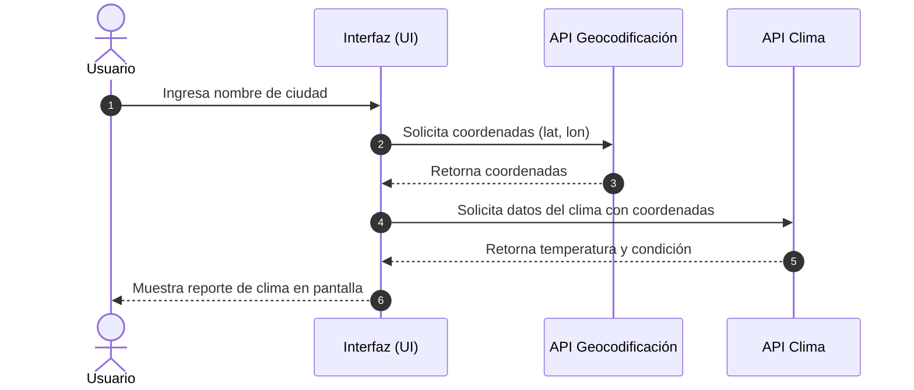

# Evaluación 03 - JavaScript (Tecsup)

[](https://developer.mozilla.org/es/docs/Web/JavaScript)
[](https://developer.mozilla.org/es/docs/Web/JavaScript/Guide/Modules)
[](#)

Solución integral de la Evaluación 03 del curso de Desarrollo Web en Tecsup. Se abarcan temas de manipulación del DOM, prevención de ataques XSS, modularización con ES6 y consumo de APIs asíncronas con optimización de rendimiento.

🌐 **GitHub Pages:** https://jesusvasquezm-blip.github.io/evaluacion03-js/

---

## Tabla de Contenidos

- [Pregunta 1: DOM y Seguridad XSS](#pregunta-1-dom-y-seguridad-xss)
- [Pregunta 2: Módulos ES6 y Falsy Values](#pregunta-2-módulos-es6-y-falsy-values)
- [Pregunta 3: Consumo de APIs y Rendimiento](#pregunta-3-consumo-de-apis-y-rendimiento)
- [Diagrama de Flujo del Sistema](#diagrama-de-flujo-del-sistema)
- [Bitácora de IA Generativa](#bitácora-de-ia-generativa)
- [Conclusión del Proyecto](#conclusión-del-proyecto)
- [Checklist de Entregables](#checklist-de-entregables)

---

## Pregunta 1: DOM y Seguridad XSS

Se implementó el registro de productos manipulando el DOM de forma segura mediante `textContent` para prevenir ataques de inyección XSS. Además, se habilitó la prueba con `innerHTML` para evidenciar la vulnerabilidad.


### Código clave (Sanitización con textContent):
```js
const tdNombre = document.createElement('td');
tdNombre.textContent = nombreProducto; // Asignación segura que escapa código HTML/JS
```

---

## Pregunta 2: Módulos ES6 y Falsy Values

Implementación de arquitectura modular basada en ES6 exportando e importando funciones clave de validación y cálculo de pedidos.

### Código clave (Mapeo y Operador Nullish Coalescing):
```js
// Uso del operador ?? para evitar fallos con falsy values válidos (como 0)
const precioFinal = producto.precio ?? 0;
const cantidadFinal = producto.cantidad ?? 1;
```

---

## Pregunta 3: Consumo de APIs y Rendimiento

Optimización en las solicitudes asíncronas para la geolocalización y obtención de datos meteorológicos.

### Código clave (Paralelismo con Promise.allSettled):
```js
const resultados = await Promise.allSettled([
  fetchGeolocalizacion(ciudad),
  fetchClima(ciudad)
]);
```

---

## Diagrama de Flujo del Sistema



---

## Bitácora de IA Generativa

| # | Pregunta | IA usada | ¿Qué propuso la IA? | Decisión | ¿Por qué? |
| - | -------- | -------- | ------------------- | :------: | --------- |
| 1 | P1 | ChatGPT | Inyectar datos usando innerHTML concatenando strings directamente. | Rechazó | Se verificó mediante prueba de penetración en consola que generaba una vulnerabilidad XSS. Se reemplazó por textContent. |
| 2 | P1 | Claude | Usar delegación de eventos en el contenedor principal del listado de pedidos. | Aceptó | Se probó la respuesta del evento al agregar elementos dinámicos al DOM y redujo el consumo de memoria. |
| 3 | P2 | ChatGPT | Validar la existencia de valores numéricos con el operador OR. | Corrigió | Al evaluar un precio de 0, el operador OR asignaba el valor por defecto erróneamente. Se corrigió usando el operador nullish. |
| 4 | P2 | Claude | Estructura de exportación nombrada en lugar de export default para los módulos. | Aceptó | Mejoró el autocompletado en VS Code y previno errores de importación al refactorizar. |
| 5 | P3 | ChatGPT | Ejecutar las llamadas de fetch de forma secuencial mediante await anidados. | Rechazó | Aumentaba el tiempo total de respuesta de la interfaz al doble. Se reemplazó por llamadas concurrentes. |
| 6 | P3 | Claude | Utilizar Promise.allSettled en lugar de Promise.all para el manejo de APIs externas. | Aceptó | Evita que falle toda la interfaz si una de las APIs externas retorna un error HTTP o de red. |

---

## Conclusión del Proyecto

Durante el desarrollo de esta evaluación se tomaron decisiones técnicas clave para garantizar la seguridad, robustez y rendimiento de la aplicación. En la Pregunta 1, se priorizó el uso de delegación de eventos y la manipulación directa del DOM usando `textContent` sobre `innerHTML`, previniendo vulnerabilidades de inyección de código XSS al registrar insumos de usuario. En la Pregunta 2, el análisis de *falsy values* permitió identificar que el operador tradicional de OR (`||`) fallaba al recibir valores legítimos como el número `0`, por lo que se optó por implementar el operador *nullish coalescing* (`??`). Para la Pregunta 3, se descartaron las peticiones secuenciales bloqueantes y se comparó el uso de `Promise.all` frente a `Promise.allSettled`; la decisión final fue utilizar `Promise.allSettled` para asegurar una tolerancia a fallos parciales cuando una API externa no responda correctamente. El soporte de herramientas de IA generativa resultó sumamente útil para acelerar la estructuración de boilerplate y sugerir diagramas en sintaxis Mermaid; sin embargo, fue indispensable la verificación humana en la consola del navegador para corregir sesgos en el manejo de seguridad y optimización de peticiones asíncronas.

---

## Checklist de Entregables

- [x] Estructura de carpetas (`p1-dom`, `p2-modulos`, `p3-api`, `img/`)
- [x] Badges de Shields.io integrados
- [x] Tabla de contenidos funcional con anclas
- [x] Código fuente sanitizado y explicado por cada pregunta
- [x] Capturas de evidencia en carpeta `img/`
- [x] Diagrama Mermaid (`sequenceDiagram`) para el flujo de la P3
- [x] Bitácora de uso de IA (6 entradas completas)
- [x] Conclusión técnica (+150 palabras)
- [x] Commits progresivos en GitHub (mínimo 6)